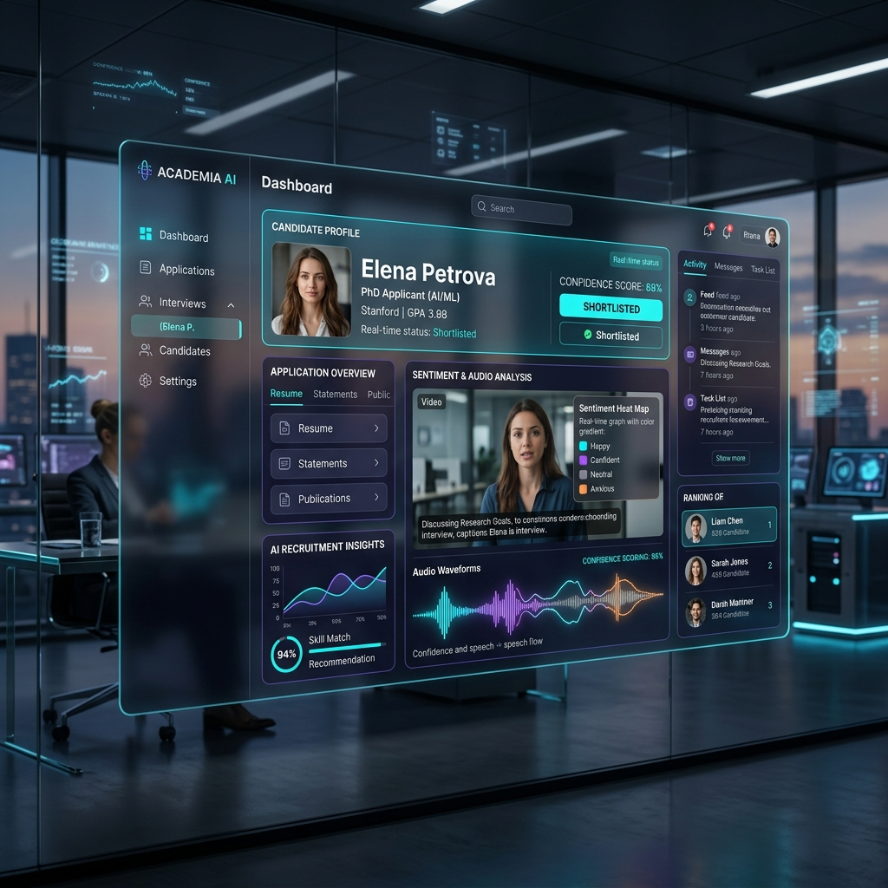

# 🎓 AI-Powered TA & LD Recruitment System
### Final Year Project — FAST-NUCES



> An end-to-end, AI-powered platform that automates the selection, evaluation, and management of **Teaching Assistants (TAs)** and **Lab Demonstrators (LDs)** at FAST University — reducing faculty workload and enabling smarter candidate screening.

---

## 📋 Table of Contents

- [Problem Statement](#-problem-statement)
- [System Architecture](#-system-architecture)
- [Modules Overview](#-modules-overview)
- [Tech Stack](#-tech-stack)
- [Project Structure](#-project-structure)
- [Getting Started](#-getting-started)
- [Database Setup](#-database-setup)
- [Environment Variables](#-environment-variables)
- [Running Each Module](#-running-each-module)
- [Screenshots & Demo](#-screenshots--demo)
- [Team](#-team)

---

## 🔴 Problem Statement

Faculty spend excessive time **manually selecting TAs** — scrutinizing applications, conducting interviews, and answering repetitive student queries. At FAST University:

- **130+ labs** require ~**270 LDs** per semester
- **100+ TAs** are needed simultaneously
- Faculty receive ~**50 repetitive emails/day** about eligibility, deadlines, and application status

This project automates the entire pipeline — from application submission to AI-scored interviews — freeing faculty to focus on teaching and research.

---

## 🏗 System Architecture

```
┌─────────────────────────────────────────────────────────┐
│                   Flask Web Application                  │
│              (Module 1 — Core Recruitment App)           │
├──────────────┬──────────────┬──────────────┬────────────┤
│  Student     │  Teacher     │  Admin       │  AI        │
│  Portal      │  Panel       │  Dashboard   │  Services  │
├──────────────┴──────────────┴──────────────┴────────────┤
│                     MySQL Database                       │
├─────────────────────────────────────────────────────────┤
│  Module 2        │  Module 3 & 4                        │
│  RAG Chatbot     │  AI Interview (Audio + Questions)     │
│  (Streamlit)     │  Wav2Vec2 • FER • Groq LLM           │
└──────────────────┴──────────────────────────────────────┘
```

---

## 📦 Modules Overview

### Module 1 — User Access & Automated Selection
> **`module1_core_app/`**

Handles the core recruitment workflow:

| Feature | Description |
|---|---|
| 🔐 Student Registration & Login | Secure session-based auth with 30-min timeout |
| 📝 LD Application Submission | Students apply for lab demonstrator positions |
| 📝 TA Application Submission | Students apply for teaching assistant positions |
| 🤖 Automatic LD Shortlisting | Rule-based algorithm considers SGPA, studied courses, credit hours |
| 📊 Teacher Panel | Faculty view allotted LDs/TAs, launch selection rounds |
| 🛡 Admin Dashboard | Manage courses, semesters, results, and allocations |
| ⏰ Semester Scheduling | APScheduler auto-detects and registers new semesters |

**Automated LD Selection Criteria:**
- Minimum SGPA threshold
- Must have studied the target course
- Priority based on grade and credit hours
- Configurable per-course rules via Teacher Panel

---

### Module 2 — AI Chatbot Assistance
> **`module2_rag_chatbot/`**

A **RAG (Retrieval-Augmented Generation)** chatbot that answers student queries about the TA/LD system:

| Feature | Description |
|---|---|
| 💬 FAQ Answering | Eligibility, deadlines, how to apply, slot limits |
| 📚 RAG Pipeline | ChromaDB vector store + Sentence-Transformers embeddings |
| 🧠 LLM Backend | Groq API (`llama-3.3-70b-versatile`) with no-hallucination prompt |
| 🖥 Streamlit UI | Clean chat interface, runs independently |
| 📄 Knowledge Base | Excel dataset (`Chatbot_Dataset.xlsx`) — easily updatable |

**How it works:**
1. Student query → embed with `sentence-transformers`
2. Retrieve top-5 relevant chunks from ChromaDB
3. Build structured prompt → send to Groq LLM
4. Return professional, context-grounded answer

---

### Module 3 — AI-Powered Interview Evaluation (Audio Analysis)
> **`module3_module4_ai_interview/`**

Conducts and scores AI-based audio interviews for TA candidates:

| Feature | Description |
|---|---|
| 🎙 Audio Recording | Browser-based WebM recording per question |
| 🧠 Wav2Vec2 Models | Three trained models (IEMOCAP tone, IEMOCAP confidence, RAVDESS multi) |
| 📈 Behavioral Scores | Confidence score (0–100%) and Tone score (4-class emotion) |
| 🎥 Video Analysis | FER (Facial Emotion Recognition) for video sentiment |
| 🔊 Audio Processing | Librosa + Pydub with ffmpeg for format conversion |
| 📋 Session Results | Per-question scores saved with full audio/video session |

**Trained Models (download separately — see note below):**
- `models/iemocap trained files/confidence_model.pt` — IEMOCAP confidence regression
- `models/iemocap trained files/tone_model.pt` — IEMOCAP tone classification
- `models/ravdess/wav2vec2_ravdess_multitask_best.pt` — RAVDESS multi-task model

> ⚠️ **Model files are NOT included in this repo** (each ~360MB). They must be downloaded or trained separately. Training notebooks are referenced in `behavioral_analysis.py` header comments.

---

### Module 4 — AI Question Generation & Verification
> **`module3_module4_ai_interview/`** *(integrated with Module 3)*

Generates course-specific interview questions and auto-grades answers:

| Feature | Description |
|---|---|
| ❓ Question Generation | Groq LLM generates course-relevant questions per exam |
| ✅ Answer Verification | LLM-based grading with structured scoring |
| 💻 Coding Questions | Python/C++/Java code execution via Judge0 CE API |
| 🐳 Docker Sandboxing | Isolated code execution (Dockerfile.cpp, Dockerfile.python) |
| 📊 Final Score | Audio behavioral score + Q&A score = final interview score |

**Supported Exam Courses:**
Database, Data Structures & Algorithms, Web Development, Machine Learning, Artificial Intelligence, Programming Fundamentals, OOP, Data Mining, Data Visualization, Data Warehousing

---

## 🛠 Tech Stack

| Layer | Technology |
|---|---|
| **Frontend** | HTML5, CSS3, Jinja2 Templates, JavaScript |
| **Backend** | Python 3.10+, Flask 2.3+ |
| **Database** | MySQL 8.0 |
| **AI / Audio** | PyTorch, Wav2Vec2 (HuggingFace Transformers), Librosa, Pydub |
| **Computer Vision** | OpenCV, FER (Facial Emotion Recognition) |
| **LLM** | Groq API (Llama 3.3 70B Versatile) |
| **Chatbot** | ChromaDB, Sentence-Transformers, Streamlit |
| **Code Execution** | Judge0 CE (via RapidAPI), Docker |
| **Scheduling** | APScheduler |
| **Environment** | python-dotenv |

---

## 📁 Project Structure

```
AI-Powered-TA-and-LD-Recruitment-System/
│
├── 📂 module1_core_app/            # Module 1: Core Recruitment App
│   ├── app.py                      # Main Flask application (all routes)
│   ├── behavioral_analysis.py      # Wav2Vec2 + FER behavioral scoring
│   ├── utils.py                    # File helpers (folder creation, saving)
│   ├── requirements.txt            # Python dependencies
│   ├── templates/                  # Jinja2 HTML templates
│   │   ├── index.html              # Login page
│   │   ├── student_welcome.html    # Student dashboard
│   │   ├── student_apply.html      # LD application form
│   │   ├── student_apply_TA.html   # TA application form
│   │   ├── teacher_panel.html      # Teacher dashboard
│   │   ├── welcome_admin.html      # Admin dashboard
│   │   ├── launch_selection.html   # Launch LD selection round
│   │   ├── launch_selection_TA.html# Launch TA selection round
│   │   ├── lds_page.html           # View allotted LDs
│   │   ├── tas_page.html           # View allotted TAs
│   │   ├── profile.html            # Student profile / grades
│   │   ├── exam_index.html         # AI interview landing page
│   │   ├── view_ta_results.html    # TA interview results (student)
│   │   ├── view_ta_results_admin.html # TA results (admin)
│   │   └── ...                     # Other pages
│   └── static/
│       ├── css/exam_style.css      # Main stylesheet
│       └── js/exam_main.js         # Frontend interview logic
│
├── 📂 module2_rag_chatbot/         # Module 2: RAG Chatbot
│   ├── src/
│   │   ├── config.py               # Groq client + ChromaDB config
│   │   ├── ingest.py               # Load Excel → embed → store in ChromaDB
│   │   ├── rag.py                  # Retrieve → Prompt → LLM pipeline
│   │   ├── streamlit_app.py        # Streamlit chat UI
│   │   ├── chat_cli.py             # CLI interface for testing
│   │   └── __init__.py
│   ├── data/
│   │   └── Chatbot_Dataset.xlsx    # FAQ knowledge base (editable)
│   ├── .streamlit/config.toml      # Streamlit theme config
│   ├── requirements.txt
│   ├── README.md
│   └── STREAMLIT_RUN.md            # How to run the Streamlit app
│
├── 📂 module3_module4_ai_interview/ # Modules 3 & 4: AI Interview System
│   ├── app.py                      # Flask app for standalone interview service
│   ├── behavioral_analysis.py      # Audio/video behavioral scoring
│   ├── utils.py                    # File utilities
│   ├── test_api.py                 # API endpoint tests
│   ├── requirements.txt
│   ├── templates/index.html        # Interview UI
│   ├── static/
│   │   ├── css/style.css
│   │   └── js/main.js              # Recording + submission logic
│   └── docker/
│       ├── Dockerfile.python       # Sandboxed Python executor
│       └── Dockerfile.cpp          # Sandboxed C++ executor
│
├── 📂 database/
│   └── sql_script.sql              # Full MySQL schema + seed data
│
├── 📂 assets/
│   └── project_thumbnail.png       # Project banner image
│
├── .gitignore
├── .env.example                    # Template for environment variables
└── README.md                       # This file
```

---

## 🚀 Getting Started

### Prerequisites

- Python 3.10+
- MySQL 8.0+
- ffmpeg (for audio processing) — download from [ffmpeg.org](https://ffmpeg.org/download.html) and place `ffmpeg.exe` / `ffprobe.exe` in `module1_core_app/`
- Git

### 1. Clone the Repository

```bash
git clone https://github.com/kkwtrt9876/AI-Powered-TA-and-LD-Recruitment-System-Final-Year-Project.git
cd AI-Powered-TA-and-LD-Recruitment-System-Final-Year-Project
```

### 2. Set Up Environment Variables

```bash
cp .env.example module1_core_app/.env
cp .env.example module2_rag_chatbot/.env
# Edit each .env file and add your GROQ_API_KEY and RAPIDAPI_KEY
```

---

## 🗄 Database Setup

```bash
# Log into MySQL
mysql -u root -p

# Run the schema script
source database/sql_script.sql
```

This creates the `flask_app` database with all required tables:
- `students`, `teachers`, `admins`
- `student_sgpa`, `student_studied_courses`
- `student_applications_LD`, `student_applications_TA`
- `semester_id_data`, `ld_finalization`, `ta_finalization`
- `helper_student_studied_courses`, `course_data`, and more

Then update the DB credentials in `module1_core_app/app.py` (lines 68–75):
```python
db = mysql.connector.connect(
    host="localhost",
    user="root",
    password="YOUR_MYSQL_PASSWORD",   # ← change this
    database="flask_app",
    port=3306,
)
```

---

## 🔑 Environment Variables

Create a `.env` file in each module directory (copy from `.env.example`):

| Variable | Description | Where to Get |
|---|---|---|
| `GROQ_API_KEY` | Groq LLM API key | [console.groq.com](https://console.groq.com) (free) |
| `RAPIDAPI_KEY` | Judge0 CE code execution | [rapidapi.com/judge0-official](https://rapidapi.com/judge0-official/api/judge0-ce) |

---

## ▶️ Running Each Module

### Module 1 — Core Flask App

```bash
cd module1_core_app
pip install -r requirements.txt
python app.py
# Visit: http://127.0.0.1:5000
```

### Module 2 — RAG Chatbot (Streamlit)

```bash
cd module2_rag_chatbot
pip install -r requirements.txt

# First time: build the ChromaDB vector store
python src/ingest.py

# Run the chatbot UI
streamlit run src/streamlit_app.py
# Visit: http://localhost:8501
```

### Module 3 & 4 — AI Interview (Standalone)

```bash
cd module3_module4_ai_interview
pip install -r requirements.txt

# Place ffmpeg.exe and ffprobe.exe in this directory
# Download AI models (see Models section above)

python app.py
# Visit: http://127.0.0.1:5001
```

---

## 🤖 AI Models

The behavioral analysis models are **not included** in this repository due to their large size (~360MB each). They were trained using:

| Model File | Dataset | Architecture | Task |
|---|---|---|---|
| `confidence_model.pt` | IEMOCAP | Wav2Vec2-base fine-tuned | Confidence regression (1–5) |
| `tone_model.pt` | IEMOCAP | Wav2Vec2-base fine-tuned | Tone classification (4-class) |
| `wav2vec2_ravdess_multitask_best.pt` | RAVDESS | Wav2Vec2-base fine-tuned | Multi-task (emotion + confidence) |

Training notebooks are located in `Ep-Y-Fe - Final/models/` in the original project.

> To use the models, place them in `module1_core_app/models/iemocap trained files/` and `module1_core_app/models/ravdess/`.

---

## 👥 Team

**Final Year Project — FAST-NUCES**

| Member | Role |
|---|---|
| Team Member 1 | Module 1: Core App & LD Automation |
| Team Member 2 | Module 2: RAG Chatbot |
| Team Member 3 | Module 3: Audio Behavioral Analysis |
| Team Member 4 | Module 4: Question Generation & Verification |

---

## 📄 License

This project is submitted as a Final Year Project at FAST-NUCES. All rights reserved by the team and university.

---

<div align="center">
  <i>Built with ❤️ at FAST-NUCES — Reducing faculty burden, one algorithm at a time.</i>
</div>
